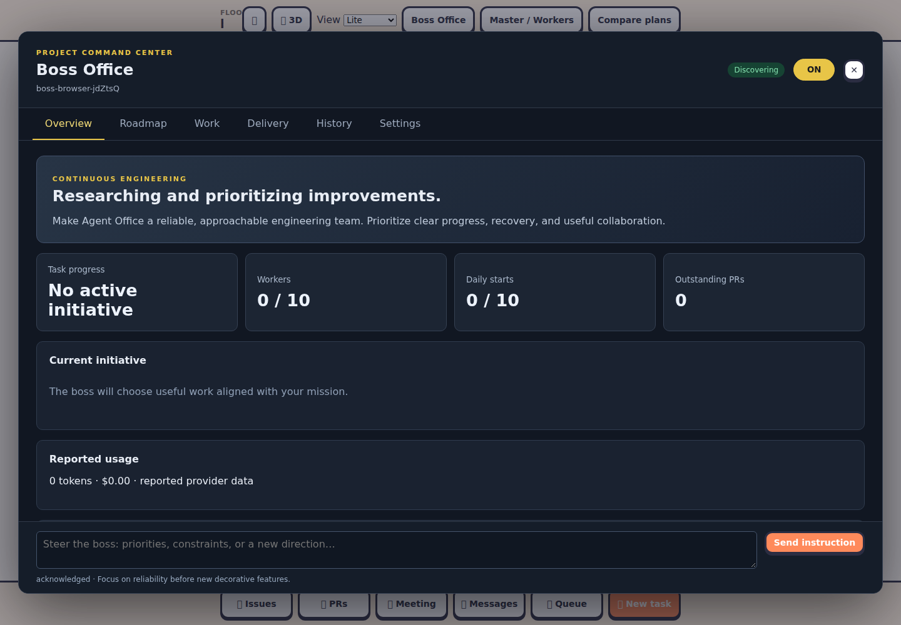
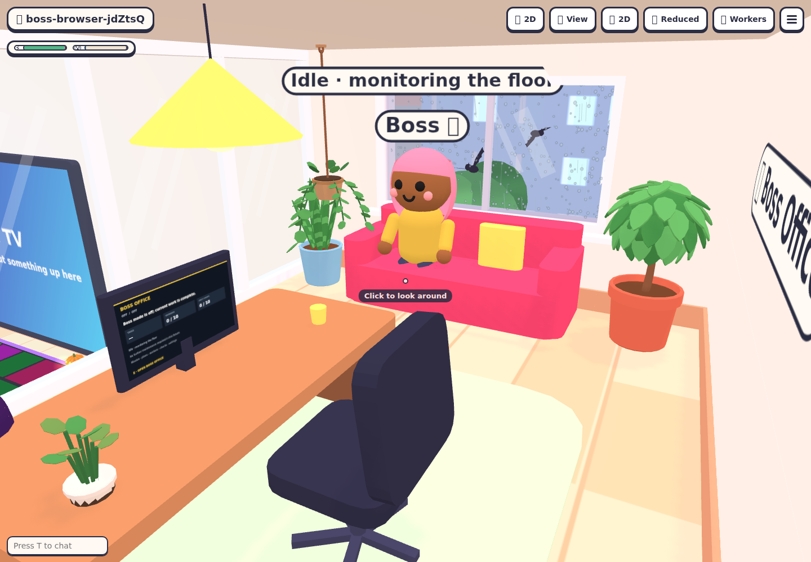

# Boss Office

Boss mode is a continuous manager for one project floor. It discovers improvements, plans initiatives, assigns workers, integrates results, verifies the delivered commit and opens PRs. It runs on the office server or floor host without an open browser.

## One console

Look at the upstairs monitor and press **E**, use the boss chair or character, or choose **Boss Office** from the menu, command palette or Lite header. Every entry opens the same console:

- **Overview:** mission, current initiative, accepted/total tasks, worker capacity, limits, reported usage and blockers.
- **Roadmap:** evidence-backed ideas, priorities, dependencies and outcomes. Admins add ideas, raise priorities or reject future work.
- **Work:** plans, assignments, agent/model choices, results, reviews and terminals. Suspended terminals resume when Boss mode turns on; viewing a suspended terminal does not silently restart it.
- **Delivery:** independent checks tied to commits, logs, PRs and review/CI follow-ups.
- **History:** decisions, steering, failures and recovery, with Markdown report export.
- **Settings:** all configuration and reusable presets. Unsaved edits survive live updates; closing or navigating asks before discarding them.

Every hired worker keeps its visible desk avatar, including discovery sessions and team coordinators. The mobile Boss character is an additional guide, so workers remain visible when Boss mode starts, stops or changes assignments.

The physical screen shows a readable progress summary and never invents percentages or ETAs. Minesweeper has been removed; the lounge arcade cabinet remains available. Closing the console with ✕ or Esc leaves the boss running and restores game controls.

[Mobile console screenshot](images/boss-mode/mobile.png) · [Boss visiting a worker](images/boss-mode/worker-visit.png).

## Configure and turn on

An admin saves a mission, constraints and independent verification commands before turning **ON**. Verification commands run as trusted shell commands in the boss integration worktree. For Node repositories, existing `typecheck`, `test` and `build` scripts are suggested automatically. Include a repository browser harness for visual changes.

Choose the boss provider, model and reasoning effort separately. Worker setup is either an **allowed model pool**, selected by the boss per task, or **explicit slots** with a provider/model/effort for each slot. Slots can repeat a model. Configure **1–10 concurrent workers**, default **3**; the boss is additional, so ten workers require room for eleven participants. Existing building capacity, provider enablement and hiring pauses still apply. Lowering the limit lets current assignments finish and prevents additional dispatch above the new limit.

Choose **roadmap-led**, **mission-led** (default), or **broad exploration** initiative selection. Roadmap-led features require evidence referencing a supplied roadmap line; other feature ideas remain suggestions. Enable work categories individually: features, fixes, dependencies, performance, documentation and architecture. The boss must explain the problem, evidence, benefit and acceptance before implementation. It retains and deduplicates the backlog and operates one implementation initiative at a time.

Limits are configurable: **120 minutes per initiative**, **10 initiative starts per UTC day**, **2 recovery attempts**, **3 outstanding PRs**, and a **5-minute discovery interval** when no eligible work exists. Provider costs may be unknown or incomplete; these limits are not a cross-provider dollar budget. New configurations apply to future initiatives; active runs retain their chosen models. Save named presets to reuse configuration on another floor.

## OFF, immediate stop and steering

**OFF** prevents new initiatives and drains the current initiative, including undispatched dependent tasks, review, verification and PR delivery. The header says **Turning off—finishing current work**. Turning ON while draining cancels the stop request.

**Stop now—keep work** suspends active terminals and preserves their identity, session, task graph and worktrees. ON reconciles unfinished work before choosing another initiative. Exhausted runtime/recovery limits preserve blocked work rather than claim success. Reprioritize blocked work to retry it.

The bottom **Steer the boss** composer records instructions immediately. The boss receives them between terminal operations, applies them at a safe checkpoint and acknowledges their IDs. Completed work is preserved. Steering history distinguishes acknowledgment from application; it never pretends delivery means the plan has already changed.

## Verification and publication

Workers commit locally; the boss reviews and integrates into its own branch. The office independently executes configured checks during finalization and verifies the PR against the pushed integration commit and completion report. Worker-reported check evidence remains separate from office-executed evidence.

The default delivery policy opens a ready PR. Known failed CI, conflicts and requested changes enqueue bounded follow-up work on the original branch and PR. Unmerged prerequisites remain blocked while unrelated work continues. Outstanding-PR limits stop new implementation until capacity returns.

Optional automatic squash merging requires passing CI, an approved review, mergeability, the configured label (`boss-automerge` by default), and independent check results for the exact PR head. The merge command matches that head to avoid racing a later push. Repository rules take precedence: `sagardhande2942/agent-office-sd` retains its author restrictions. Bitbucket deliveries remain PR-based when commit-specific automatic merge eligibility cannot be established. Agents are instructed not to merge themselves.

## Character and recovery

The boss walks through the floor and upstairs, visits workers during coordination or result review, and sits on the office sofa when idle, waiting or off. Movement follows server-owned paths and timestamps; it does not delay execution. Players keep priority over sofa places. Other maps use an available compatible seat or safe idle location. Look at the boss and press E to open its console.

Automatic restart recovery is enabled by default. Saved activity, worktrees and PRs are reconciled rather than recreated. Explicitly stopped bosses remain stopped. Missing credentials, revoked admin access or missing worktrees produce a visible blocker. Disabling automatic recovery leaves the boss off after a restart.

Local workers use the initiating admin’s existing credential context; hosted floors use the host’s sign-ins and require current office authorization/capacity grants. Update both office and floor host for hosted Boss mode. Execution continues without a browser; a disconnected host cannot obtain new authorization grants.

State is saved atomically with owner-only permissions under the project’s `.agent-office/`: `boss-mode.json` and per-initiative `boss-team-<id>.json`. Corrupt state is reported without overwriting it. The backlog retains up to 500 initiatives, 1,000 recent decisions, 100 steering instructions and 100 verification records. Keep secrets out of missions, proposals and instructions.

## CLI and worker tools

In `agent-office tui`, use `:boss` for status, `:boss-on`, `:boss-off`, `:boss-stop`, `:boss-steer <instruction>` or `:boss-config <JSON-file>`. The same admin checks apply.

Boss participants use `office-workers boss state` and `office-workers boss action < action.json`, or `boss_state` / `boss_action` MCP tools. Discovery submits bounded evidence-backed proposals with the current state revision. Only the active boss can propose, report focus on its own workers, or acknowledge steering. Team planning and result submission continue through existing `team_state` / `team_action` tools.

## Verification

Run `npm run typecheck`, `npm test`, and `npm run build`. Run `node --import tsx scripts/e2e-boss-mode.mjs` for desktop/mobile console, game focus, physical monitor and character screenshots in `/tmp/agent-office-boss-evidence` (override with `BOSS_ARTIFACTS`). The harness uses fake agent executables and isolated Git repositories; it makes no paid agent calls.

Run `node --import tsx scripts/e2e-worker-avatars.mjs` for an isolated headless check that hired avatars remain visible with Boss mode on and after coordinator roles clear. Set `CHROMIUM_PATH` to a Chromium executable and optionally `AVATAR_ARTIFACTS` for the screenshot directory. The fixture injects worker protocol messages and launches no agents.

## Mission and steering priority

The latest explicit user direction takes priority over inferred improvements and an earlier initiative. In mission mode, discovery should propose work that directly fulfills the mission; a repair may come first only when it is a concrete prerequisite, explained in the proposal evidence.

Changing the mission or sending steering returns queued initiatives to suggestions for reconsideration. Active work, commits and PRs are preserved; its master receives the new direction at a safe checkpoint and reconciles pending tasks. Changing agent/model settings alone does not reset queued work.

Discovery receives outstanding instructions when its terminal becomes idle. Failed delivery remains retryable, including after restart. Discovery must apply and acknowledge the current direction before the server accepts proposals. Multiple instructions are delivered in order with explicit precedence for newer conflicting instructions; receipt is not the same as the agent acknowledging application.
