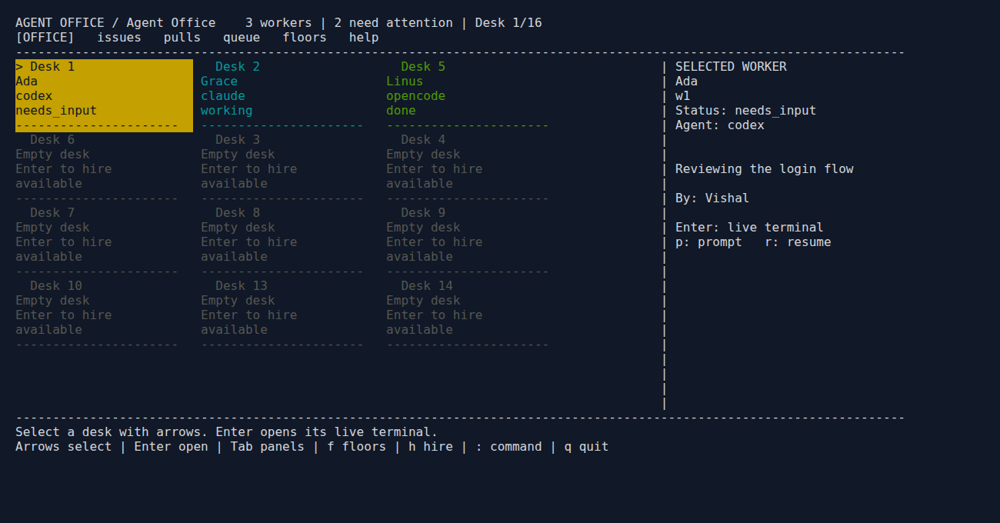
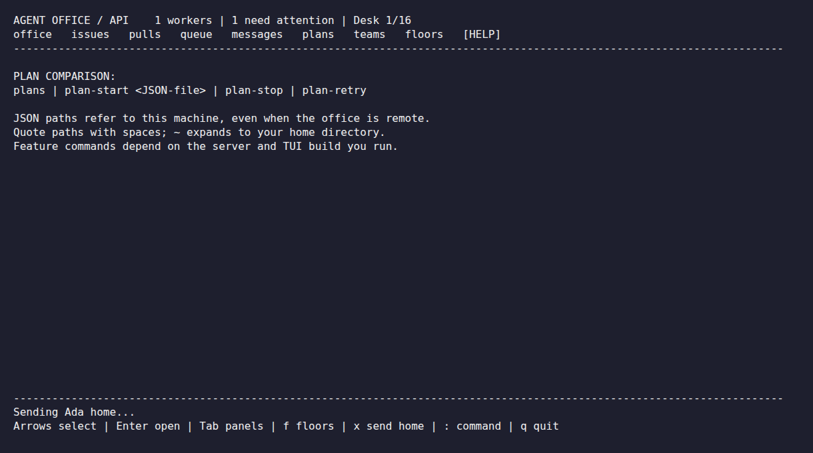

# Terminal office

For shell commands, flags, dashboard keys and Cloud Shell restart instructions, see [cmd.txt](../cmd.txt).

The CLI is a third view of the same office, alongside 3D and `/lite`. Run the server first, keep it running, then join it in another terminal:

```sh
agent-office /path/to/your/project --no-open
# In a second terminal:
agent-office tui
```

From a source checkout, use the same checkout/build for both processes:

```sh
cd /path/to/agent-office-sd
npm ci
npm run build
# Terminal 1 (leave running):
node bin/agent-office.js /path/to/your/project --no-open
# Terminal 2, from the same checkout:
node bin/agent-office.js tui
```

`agent-office tui` connects to a server; it does not start one. Use `--office http://localhost:4700` if you started the server on port 4700. A missing compiled CLI asks you to build; a refused connection tells you to start the server. Feature-branch commands require a build containing that feature in both processes. Installing or running a released package does not pick up an unmerged branch.

Enter the office password at the hidden prompt. If `AGENT_OFFICE_PASSWORD` is set, the client uses it instead. Passwords and session cookies are never saved by the client. With an individual account, use `agent-office tui --name ada` and enter that account's password.

For a remote office use `agent-office tui --office https://office.example.com`. An existing SSH tunnel works with the default `http://localhost:4600`. TLS certificates must be trusted by Node; self-signed offices need their certificate installed as a trusted CA (for example through `NODE_EXTRA_CA_CERTS`).

After login, the office fills your terminal with a live desk grid. Workers are colored by status: yellow needs input, green is done, cyan is working. The selected desk is highlighted. Empty desks remain visible and Enter opens hiring there. Larger terminals show the selected worker's details beside the grid; smaller terminals page through desks as you move.

| Key | Action |
| --- | --- |
| Arrow keys | Select desks or scroll a board |
| Enter | Open a worker terminal, hire at an empty desk, or enter a selected floor |
| Tab / Shift+Tab | Cycle panels |
| `f`, `i`, `b`, `t`, `m` | Floors, issues, PRs, task queue, worker messages |
| `n` | Next worker needing input or finished |
| `h`, `p`, `r` | Hire, prompt selected worker, resume selected worker |
| `x` | Open send-home choices: arrows or 1/2/3 select cleanup, Enter confirms, Esc cancels |
| `c` | Write a chat message |
| `:` | Open the command prompt |
| Esc | Cancel the prompt or return to the desk grid |
| `?` | Help |
| `q` / Ctrl+C | Leave the dashboard |



Press `:` **once**, type a dashboard command, then Enter. For example, type `hire codex Fix the failing tests`. Do not run `node`, `npm`, or `agent-office` inside this prompt; those belong in your shell. Pasting an example with a leading `:` is accepted.

`?` opens scrollable help with setup hints and examples. Team and plan panels refresh as results arrive. Arrow keys can scroll the entire help, plan, or team output.

Type commands after pressing `:`:

| Command | Action |
| --- | --- |
| `floors`, `go <id or name>` | List and switch project floors |
| `workers` | List IDs, names, statuses and current activity |
| `hire codex <prompt>` | Hire at an empty desk on the current floor |
| `attach <worker>` | Open the shared live terminal; Ctrl+] returns to the office |
| `prompt <worker> <text>` | Send the worker a prompt |
| `resume <worker>` | Resume a stopped worker |
| `home <worker> [--cleanup auto\|keep\|worktree\|all]` | Open send-home choices (Keep both selected); explicit cleanup skips the chooser |
| `pr <worker>` | Ask the office to push and open the worker's PR |
| `messages [request-id]` | Read tracked worker requests and replies; Enter opens a thread |
| `issues`, `pulls`, `queue` | Read the current boards and queue |
| `enqueue <text>` | Add a task to the existing queue |
| `chat <text>` | Send chat to teammates |
| `help`, `quit` | Show help or leave the client |

Worker commands accept an exact ID or a single-word name. Use IDs for names with spaces or duplicate names. The hire providers are `claude`, `codex`, `opencode`, `grok`, `muse`, `dsh` and `custom`. New Git-project workers use an isolated worktree by default; queue tasks follow the office's existing queue rules.

Workers using a shared checkout show deletion choices as unavailable and keep the checkout and branch when sent home. Meeting checkout cleanup is managed by the meeting.

Terminal input, including Ctrl+C, goes to the attached worker. Ctrl+] detaches. Resizing your terminal resizes the shared worker terminal for all viewers. Outside attachment, `q` or Ctrl+C exits the client. Esc returns to the desk grid; while attached, Esc goes to the worker like other terminal keys. Exiting leaves the server and workers running. If disconnected, rerun the command to sign in again.

This first CLI view requires an interactive terminal and an existing project floor. Add floors using the browser office. Voice, whiteboards, spatial activities and account administration remain in the existing interfaces.

Tracked worker message commands and receipts are described in [communications.md](communications.md).

## Plan comparison

Press `:` in the dashboard. `plans` opens plan comparison status, detailed plans and reviewer reasons. `plan-start /absolute/path/task.json` starts 1–5 distinct planning models and one reviewer; `plan-stop` closes it with participant cleanup (preserving the winner’s checkout after implementation starts), and `plan-retry` retries blocked cleanup. These commands have no additional flags. Use `attach <worker-id>` for a participant terminal and Ctrl+] to return. See [plan comparison](plan-comparison.md) for JSON configuration and provider limits.

### Scrolling worker terminals in the CLI

While attached in `agent-office tui`, use the **mouse wheel** or **Page Up / Page Down** to review up to 5,000 lines of worker history. These gestures stay local rather than being typed into the worker. Page Down or scrolling down returns to live output; typing also returns to live output and sends your input normally. Ctrl+] returns to the dashboard. History is kept only for the attached worker and released on detach; full-screen workers are mirrored into a buffer that retains scrollback.

## JSON files and errors

Team and plan commands read files on the machine running the TUI, including when connecting to a remote office. Absolute paths are clearest; relative paths use the directory where you launched the TUI. Home paths such as `~/plans/task.json` and quoted paths such as `plan-start "/home/ada/My Plans/task.json"` work. Missing files and malformed JSON produce a retryable message in the dashboard.



To reproduce the real PTY checks and a headless help screenshot, run `node --import tsx scripts/e2e-tui-guidance.mjs`. Artifacts go to `/tmp/agent-office-tui-guidance-evidence` (override with `TUI_GUIDANCE_ARTIFACTS`).
