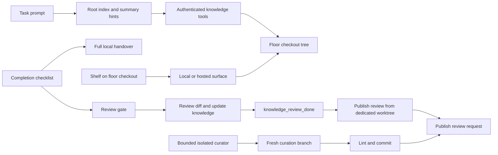

# Knowledge Tree architecture

Back to the [README](../README.md). Operation and formats: [Knowledge](knowledge.md). Legacy behavior: [Lore](lore.md).

## Modules and seams

| Module | Responsibility |
| --- | --- |
| `src/shared/knowledge-index.ts` | Frontmatter validation, index parsing and canonical sorted serialization |
| `src/shared/worker-knowledge.ts` | Summary-only bootstrap, task scoring, recency, globs and usage boost |
| `src/server/knowledge/store.ts` | Seeds, guarded relative paths, atomic private-mode writes, note/index operations and local state |
| `src/server/knowledge/delivery.ts` | Separate review publication, snapshots and guarded merge synchronization |
| `src/server/knowledge/settings.ts` | Validated floor-local settings |
| `src/server/knowledge/hooks.ts` | Worker-owned loopback API, authentication before and after body read |
| `src/server/knowledge/worker.ts` | Prompt hook, completion gate, full journals and MR-section formatting |
| `src/server/knowledge/lint.ts`, `migrate.ts`, `cli.ts` | Explicit lint/repair and idempotent legacy import |
| `src/server/knowledge/surface.ts`, `host.ts` | Floor checkout human actions and host RPC |
| `src/server/knowledge/curation.ts`, `curator.ts` | Batch schema/guards, branch curation, schedule, Git publication |
| `bin/office-knowledge-tools.js` | CLI parser and MCP schemas through the worker extension registry |
| `src/shared/protocol/knowledge.ts` | Dedicated browser request and response types |
| `src/server/ws/handlers/knowledge.ts` | Floor-scoped browser handler registry |
| `src/client/state/slices/knowledge.ts` | Dedicated tree, selected-note and status state |
| `src/client/features/knowledge/` | Installed window transport, tree/Markdown browser, editor and journal promotion |

The shelf keeps the existing `loreShelf` fixture, `lore` interaction kind and 📜 menu action. `installLore` delegates opening to the installed Knowledge window. Feature logic stays in modules; composition roots only register them.

Worker lifecycle features register through `server/worker-features.ts`. A generic `WorkerFeature.completion` hook runs after checklist validation and before manager persistence; a returned instruction holds acceptance. The Knowledge feature stores one prompt guard per `(workerId, completionRevision)`. Required policy rejects every missing-review submission until the revision has a review; prompt policy reminds once. A record in `reviews.json` satisfies that revision. An actual new task revision gets another opportunity to review.

## Disk and safety

Each directory has a machine-parsed `INDEX.md`. Each note has required title/summary frontmatter and a free-form Markdown body. Index links address immediate children; directory links point to the child's `INDEX.md`. Active and verification entries are distinct from the parsed archived block. Metadata updates regenerate the parent's sorted block without rewriting sibling notes.

The store resolves every Markdown path beneath the configured root and checks ancestors for symlinks. `_meta` is not exposed through worker reads/writes; indexes cannot be written directly by workers. State files validate their own ancestors, too. Private directories/files use 0700/0600 and tmp-then-rename publication. A note over the byte cap is rejected, rather than sliced. Credential patterns inherited from repository evidence filtering are applied to writes and lint.

Frontmatter intentionally implements a constrained YAML subset, not arbitrary YAML evaluation. Scalars and inline string arrays round-trip through JSON-compatible serialization. Invalid frontmatter produces a browser warning and is excluded from hints; lint will not rewrite it. Worker tools have no delete operation. Human deletion removes the note locally for later publication; restoring publishes a separate knowledge-only revert proposal.

A shared filesystem lock serializes mutations across processes; versions checked under the lock reject stale external edits. Canonical indexes regenerate from child notes. Abrupt termination requires recovery of the empty write.lock directory after confirming writers are stopped.

## Context boundaries

Bootstrap uses the root index, pinned titles/summaries and scored hints, never body content. File path globs, update decay and local usage contribute to scores; archived and invalid notes do not. Context budgeting drops whole lines, reserves an explicit omission marker, and never slices a line. Extremely small/invalid budgets are rejected by configuration.

`knowledge_read` returns all text by default and explicit line-page metadata when requested. Search returns literal matches with adjacent lines, a bounded hit count and an omitted count. Read counts are local telemetry. Knowledge read/write author identity comes from the authenticated worker; request bodies cannot choose worker IDs or authors.

The floor checkout is the live central brain. The human browser and every authenticated worker operate on that same knowledge tree regardless of the worker's code worktree, so updates are immediately shared across the floor. Remote floors use `knowledge.execute` through the existing host-call allow-list. Curator proposals remain on the review branch; Sync approved applies merged changes with their intended lifecycle status. Journals and review state remain floor-local.

## Curation and rollout

Tree curation reuses the existing isolated Claude/Codex adapters, scheduler and bounded committed evidence reader, but uses Git branches instead of an in-place overlay journal. Response validation is all-or-nothing. Actions may only address exact supplied note/journal paths and predeclared destinations; handovers are promotion-only. Application checks the snapshot, including same-day concurrent edits, before changing a note.

Runs rotate batches. Exact-duplicate pairs and referenced-file changes since `verified_at` become deterministic actions. The remaining notes go to the model with bounded committed excerpts. Notes and evidence are untrusted input. Generated output still passes store credential/size checks and lint. A failing run keeps its reviewable branch/worktree; schedule state and the last 20 runs stay under `_meta/state`.

The default tree curator uses `gh pr create --repo <origin owner/repo> --base main --head <branch>` for GitHub, and `glab mr create` for GitLab. It uses the same origin it pushed to. Worker MR updates remain a worker instruction with a pasteable journal section; there is no forge SDK or office-owned MR-body update.

Compatibility is explicit: `legacyLore` re-enables old injection/curation for one transition release; legacy files and modules remain for migration. Default floors use `LoreStore` only as the dormant legacy read surface and create no `lore-curator.json`. Remove those compatibility modules after the transition, not while existing floors still require import.

## Evidence

`tests/knowledge.test.ts` covers format round trips, sorting, path/symlink/credential guards, paging, search context, index repair, corruption preservation, budget/scoring, review policies/revisions, journal idempotency, pending shared edits, MR sections, migration and curator guards. Existing CLI, worker permissions and client-state contract tests include Knowledge fields/tools. Three fixture E2Es cover shared knowledge and isolated code worktrees, shelf status-preserving edits with screenshots, and branch curation with a mocked review publisher. CI runs knowledge lint alongside typecheck, tests and build.

## Shared-store delivery

Worker tools resolve the floor checkout, independently of worker code worktrees. Reads return content versions; external mutations require those versions. The store serializes mutations and checks versions inside the lock. Required review blocks every completion attempt until the current revision has a review. Legacy commitMode values no longer commit to either checkout.

`delivery.ts` owns snapshot publication and merge synchronization. It overlays local note deltas on fresh origin/main, regenerates indexes, publishes a dedicated review, and records before/after snapshots in local state. Remote fetch, push and forge commands are asynchronous. Curator actions use the same path: proposals never mutate live notes before acceptance. Sync preflights every affected note and only applies an approved set when no newer live or upstream edits would be overwritten.
