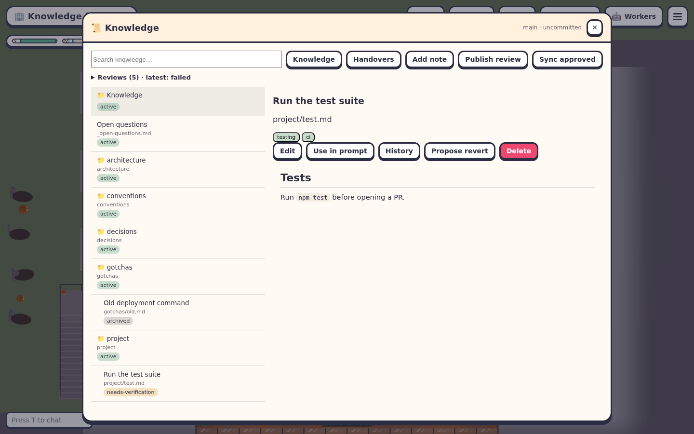

# Knowledge Tree

Back to the [README](../README.md). Engineering details: [Knowledge architecture](knowledge-architecture.md).

The Knowledge shelf is a hierarchical Markdown knowledge base committed with the project. Workers start with the root index, pinned note summaries and task hints. They read the notes they need; note bodies are never automatically injected or sliced. Agents maintain the tree themselves.

## Browse and edit

Press **E** at the shelf on the west wall beside the basketball hoop, or choose **📜 Knowledge base** in **☰**. The left pane lists directories and notes; the right pane renders Markdown. Every row shows its lifecycle status, including archived and needs-verification notes. Search returns matched lines and adjacent context. Tags are displayed with the selected note.

Review history is collapsed into a status summary above the tree. Expand **Reviews** to read recent delivery errors and review links; long logs scroll inside that section. The tree and selected note scroll independently, and stack vertically on narrow screens.

Curator plans must use each source, merge target and split destination in at most one action. If the agent returns overlapping actions, the host sends the conflicting paths back for one complete replacement plan before making any edits. A second conflict fails the run and retains its review branch; choose one operation per note and defer additional cleanup to a later run. Other validation failures and provider errors do not trigger this correction attempt.

Saving an active note through the shelf records `human_verified_by`. Existing active notes with a `human:` author are also treated as human-verified. Curation preserves that verification when repository excerpts are missing or incomplete. A proposed downgrade requires cited repository evidence plus a concrete `contradiction`; it still needs PR review and synchronization. Changes to referenced files alone do not automatically flag human-verified active notes.



The branch label identifies the floor checkout. All workers, including workers with separate code worktrees, read and edit this shared tree immediately. Each note read returns a `version`. Editing, moving, archiving or deleting an existing note requires that version as `expectedVersion`; a new note uses `null`. Stale edits are rejected so the writer can reread and reconcile both changes. File mutations are serialized across processes. A process crash can leave `_meta/state/write.lock`; after confirming no host/CLI is writing, remove that empty lock directory and retry.

**Publish review** snapshots pending knowledge into a dedicated worktree branched from freshly fetched `origin/main`, then commits and publishes a GitHub PR or GitLab MR. It preserves the floor branch, staged code, and worker worktrees. It checks the origin URL and refuses overlapping upstream note edits. Only one knowledge review may be in flight per floor. The shelf shows published, merged, closed and failed deliveries with their review link. Failed publishing retains its branch/worktree for recovery.

HTTPS and SSH origins ending in `.git` use the repository name without that transport suffix for forge commands. If an older run failed with “Could not resolve to a Repository” and a name ending in `.git`, its proposal remains on the displayed review branch. After updating the office, rerun curation or recover that retained branch to preserve its exact proposal.

**Sync approved** checks the forge review status and fetches `main`. Open reviews remain proposals; closed reviews preserve live notes. Merged changes apply as a complete set only when the live notes still match the captured snapshot or accepted result, and upstream content matches the proposal. This preserves archive/verification status and removes the old path of a move. Concurrent edits, including newly created destinations, stop the entire application with a list of paths to reconcile. Review the retained delivery snapshots in `_meta/state/deliveries.json` alongside the PR; reconcile the live files to the accepted proposal and retry. If the PR itself was edited after publication, reconcile its recorded `after` snapshot to the reviewed merged content before retrying. Keep a backup when performing this host recovery operation.

Edit preserves sources, pinned state, paths and verification metadata. **Use in prompt** copies a relative path and a `knowledge_read` instruction. **Delete** removes a shared note locally; publish its removal through review. Pending notes remain local until published and merged; Git history alone is not a backup of unpublished changes.

**Handovers** lists local shift journals. Journals are read-only, full-length evidence from workers, not independently verified facts. **Promote to knowledge** opens an editor prefilled with the journal; write a durable, focused note with evidence before saving. **History** uses Git, and **Propose revert** publishes a separate review reversing a knowledge-only commit, refusing to overwrite later note edits.

Closing the window with its top-right ✕ or Esc uses the office's normal modal/pointer-lock lifecycle.

## Worker tools

MCP and CLI share `/office/workers/knowledge`, authenticated with the worker's own hook token. Paths are relative to the configured knowledge root, not the repository root.

```sh
office-workers knowledge index
office-workers knowledge index architecture/server
office-workers knowledge read project/test.md
office-workers knowledge read project/test.md --offset 20 --limit 40
office-workers knowledge search "npm test" --scope project
office-workers knowledge write <<'JSON'
{"path":"project/test.md","frontmatter":{"title":"Run tests","summary":"Run npm test and the fixture E2Es","tags":["testing","ci"],"pinned":true,"paths":["tests/**"]},"body":"Run `npm test`. Record the actual result before opening a PR.\n","expectedVersion":null}
JSON
office-workers knowledge mv project/test.md project/testing.md --expected-version <version-from-read>
office-workers knowledge archive project/testing.md "Replaced by new test runner" --expected-version <version-from-read>
office-workers knowledge review <<'JSON'
{"changed":["project/testing.md"]}
JSON
```

The corresponding MCP names are `knowledge_index`, `knowledge_read`, `knowledge_search`, `knowledge_write`, `knowledge_move`, `knowledge_archive`, and `knowledge_review_done`. Write supports `howto`, `gotcha`, `decision`, and `module` templates. Worker identity, author and updated date are assigned by the server. Workers cannot write indexes or `_meta`, follow symlinks, access parent paths, or delete notes.

A read returns the complete file by default. Optional paging uses zero-based line offsets and returns total lines and the next offset. Search is a case-insensitive literal search of frontmatter and bodies; each hit includes the matched line and one line of context on each side. It reports the number of omitted hits. Search never returns entire notes automatically.

## Writing and indexes

The office seeds `INDEX.md`, `_meta/config.json`, empty indexes in `project`, `architecture`, `conventions`, `gotchas`, and `decisions`, and `_open-questions.md`. It does not invent build/run/test facts. Write operational notes after observing commands and their results.

Write for a stranger. Include commands verbatim. Keep one topic per file; rationale and detailed operational steps are welcome. Split files beyond about 200 lines, or directories beyond about 40 entries. Never paste secrets.

```markdown
---
title: Run the test suite
summary: npm test and the fixture browser checks
tags: [testing, ci]
status: active
pinned: true
paths: [tests/**]
sources: [PR 123, commit abcdef123]
author: worker:ada
updated: 2026-10-13
verified_at: abcdef123
---
Run `npm test` from the repository root.
```

Only title and summary are required. Frontmatter supports single-line scalars and inline arrays; quoted strings and JSON-style arrays are supported. Multiline YAML, aliases, nesting and arbitrary YAML objects are rejected. Bodies are free-form Markdown. Indexes contain sorted, single-line child links under `## Entries`; archived notes go under `## Archived`. Writes create intermediate directory indexes and update the immediate parent automatically. Index prose is retained when entries are regenerated.

## Completion review

The default required policy holds the first completion submission when that worker/task revision lacks a review. The tool returns a follow-up instruction to inspect `git diff <base>...HEAD`, update durable knowledge, record the review and resubmit the checklist. A no-change review is valid and needs `none_reason`.

Required policy continues rejecting completion until `knowledge_review_done` is recorded for that revision. An explicit `none_reason` is valid when there are no durable changes. Prompt policy is advisory and off skips the gate. Review records are worker-reported evidence, not independent verification.

Workers list the changed shared paths and their pending review status in the task PR's Knowledge base updates section. They do not commit those files from their code worktree. Use **Publish review** for durable delivery, or enable scheduled curation to publish a separate knowledge review. The local handover retains full completion evidence and the knowledge section.

## Configuration and limits

Put per-floor settings in `<project>/.agent-office/knowledge.json`. Omitted fields use these defaults:

| Setting | Default |
| --- | --- |
| `dir` | `.agent-office/knowledge` |
| `bootstrapBudgetChars` | `4000` |
| `hintCount` | `8` |
| `reviewPolicy` | `required` (`prompt`, `off` supported) |
| `commitMode` | `none`; legacy `worker`/`office` values remain readable but never commit to the floor or worker branch. Use Publish review. |
| `mrSection` | `true` |
| `maxNoteBytes` | `65536` |
| `searchMaxHits` | `40` |
| `handoversDir` | `.agent-office/handovers` |
| `legacyLore` | `false` |

Knowledge is committed except `_meta/state/`, which contains local usage counts, review records, prompt guards and curator schedule/run state. Journals are also local and gitignored. Seeding adds explicit `.gitignore` exceptions for the knowledge tree; review and commit that ignore change alongside the first knowledge commit. A fresh checkout therefore has seed changes until its first knowledge commit.

Writes reject files over 64 KiB and warn beyond 16 KiB. Directory indexes warn beyond 40 entries. Bootstrap drops whole lines/entries and explicitly says to call `knowledge_index` when entries were omitted. There is no note-body slicing. Hints use title, summary, tags, paths, update recency and local read counts; short technical tokens (`ci`, `js`, `ts`, `db`, `ui`, `pr`, `mr`) participate. Needs-verification hints are labelled; archived or invalid notes are excluded.

## Lint and migration

Run in the project checkout:

```sh
agent-office knowledge lint
agent-office knowledge lint --fix
agent-office knowledge migrate
```

From source, use `node --import tsx src/server/cli.ts knowledge lint`. Lint checks directory indexes, child membership, sort order, valid frontmatter, byte limits, symlinks and credential patterns. Fix regenerates entry blocks from children's frontmatter; invalid notes are reported and never rewritten. Resolve an index merge conflict by keeping both branches' notes, then regenerating the index.

Migration imports legacy `.agent-office/lore/*.json` into `_imported/`, puts archived/superseded discoveries in `_imported/_archive/`, and moves handover **copies** to the local journal. It maps provenance and historical update dates, generates indexes, and leaves all original JSON untouched. Re-running skips already imported files. Credential-bearing or malformed notes are reported rather than committed.

The floor checkout is the live central knowledge store. Worker discoveries and shelf edits are immediately shared. Curator changes remain on their review branch until merged and applied with **Sync approved**; the shelf links to that proposal. A review is the persistence and acceptance boundary for curator changes.

The old worker Lore endpoint is disabled by default and directs callers to the Knowledge tools. `legacyLore: true` retains the old worker-memory injection and curator during the transition release. Compatibility modules remain available for this rollout; the Knowledge shelf uses the new tree. Run migration before switching a populated floor to the tree. Removal of the old modules is a subsequent compatibility-breaking step.

## Curator

The existing Knowledge curator settings control the tree by default: completion debounce (30 seconds), interval or daily IANA scheduling, pause/resume, one catch-up and exponential 5–60 minute retry. Models still run noninteractively in empty temporary directories with tools, hooks and MCP disabled, five-minute timeouts and a 1 MiB output cap.

A run fetches `origin/main`, creates `agent-office/knowledge-curation/<date>-<id>` in a separate worktree, and reviews bounded batches plus committed repository evidence. Its review request title starts with `[Knowledge]`. Exact duplicates and changes since `verified_at` are handled without asking the model for those notes. Models may merge, split, move, archive, flag, verify, rewrite summaries, fix indexes and promote read-only journals. All action paths and new destinations are supplied in advance; the whole response is validated before applying it. Concurrent changes and new destination collisions are guarded by full note snapshots. The approved set is applied together, so a conflicting move never deletes its source.

After lint, changes are committed, pushed to the verified origin, and published with the matching GitHub/GitLab CLI. The floor branch is never switched. Failures retain the curation branch/worktree for inspection and report it in the run summary. Git history replaces the old overlay journal for the new tree; legacy originals remain untouched.

Verification scripts use fixture agents and isolated Git repositories:

```sh
node --import tsx scripts/e2e-knowledge-tree.mjs
node --import tsx scripts/e2e-knowledge-shelf.mjs
node --import tsx scripts/e2e-knowledge-curator.mjs
```

The browser script finds installed Playwright Chromium or accepts `CHROMIUM_PATH`; screenshots and checks go to `/tmp/agent-office-knowledge-evidence` (override `KNOWLEDGE_ARTIFACTS`). The curator fixture mocks MR publishing rather than creating an external review request.

Curator failures show bounded, credential-redacted explicit CLI error lines and the model used by the run. Echoed prompts containing error-related words are excluded. If the CLI provides no recognized error line, the run reports that no diagnostic was returned. If a provider request fails intermittently, retry Run now; a failed proposal remains available for inspection.
