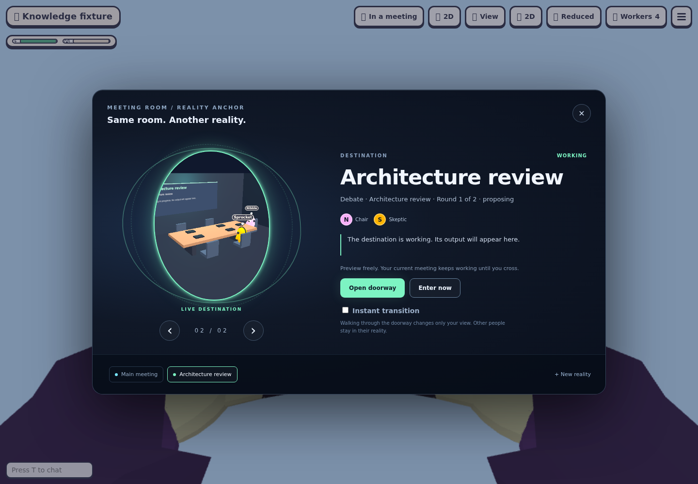
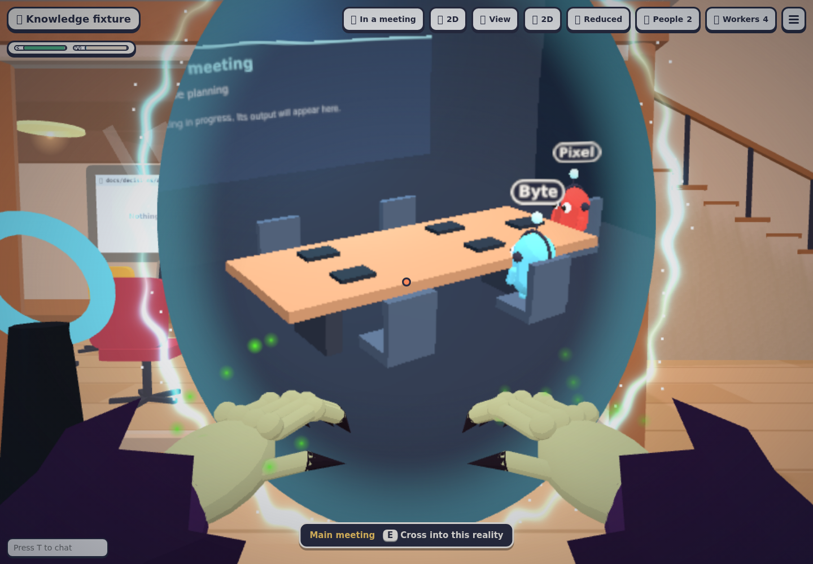

# Meeting reality portals

Back to [Meeting spaces](meeting-spaces.md) or the [README](../README.md).

The **Reality Anchor** gives the meeting room a walk-through doorway into another meeting space. It previews the destination before you cross; looking through it never starts agents, changes your selection, or moves another viewer.

## Cross into a meeting

1. On a floor with meeting spaces, open **Reality Anchor** from the **Tab** menu, the meeting window, or by pressing **E** at its physical device beside the Office meeting-room entrance.
2. Turn the destination dial with the arrow buttons, Left/Right keys, or named reality buttons. Each persistent space has a stable accent color. The preview shows existing character models for its current participants, live status, meeting progress, and an excerpt of its output.
3. Choose **Open doorway**. The window closes and a glowing portal opens beside the meeting-room entrance. Walk through its opening, or aim at it and press **E**, to enter the destination. Walking beside it does not switch.
4. A short ripple marks your crossing. You remain on the same floor, at the same position, while the meeting agents and board change to your selected space. Its name appears briefly on arrival and remains on the anchor plaque.

**Enter now** changes your view without walking to the doorway. **Instant transition** skips the cinematic sweep and sound; it defaults on when your system requests reduced motion. The 2D office supports the same destination dial and Enter now controls. The physical anchor is on the Office map; on other maps use Enter now.

The doorway expires after 45 seconds. **Esc** closes an open doorway. **Esc** or the top-right **✕** closes the destination window and restores scene controls directly, with no extra click. Closing a preview does not select its destination. Changing floors, taking the elevator, visiting the roof, or changing maps cancels an open portal and any pending crossing.

## Unwritten realities and background attention

Use **+ New reality**, enter a name, and choose **Create reality**. This creates an ordinary persistent meeting space on the current floor and previews its empty table. It hires no agents. Cross into it, then use the normal meeting room to start its first meeting. The existing space name, duplicate-name, and 16-space limits apply.

A warm amber light on the physical anchor signals another meeting needs attention. The destination dial names each space’s status. Other meetings keep working while you preview, cross, or close the window. **N**, waiting indicators, Stop, Finish, and Clear retain their existing space-scoped behavior.

Selection stays personal and is remembered per floor. Other viewers may see a brief presence ripple when you cross, but their space never changes. This is a visual navigator over the existing [local and remote meeting spaces](meeting-spaces.md), with the same host version, provider, worker-capacity, Git-isolation, and recovery requirements.

## Fast switching and accessibility

The original **Meeting space** dropdown remains under **Instant switch** in the meeting window. It changes your selection immediately. The Reality Anchor includes named destination buttons, keyboard navigation, a text description of the live preview, a direct Enter now button, and a top-right close control. Meaning is shown in text as well as color. Sounds respect the office volume and mute settings; reduced motion keeps the portal border still and skips the crossing sweep.

## Verification

Run `npm run typecheck`, `npm test`, and `npm run build`. Then run `CHROMIUM_PATH=/path/to/chrome node --import tsx scripts/e2e-meeting-portals.mjs` for live preview rendering, cancellation, independent viewers, physical crossing, no-agent creation, mobile layout, reduced motion/2D, floor cleanup, and WebGL error checks. The harness uses idle fixture agents with no paid model calls. It renders the destination preview normally and enables the full office renderer for the physical doorway screenshot; expensive unrelated office rendering is skipped during UI checks.

Screenshots and `checks.json` are written under `/tmp/agent-office-meeting-portals-evidence`, configurable with `MEETING_PORTALS_ARTIFACTS`.
