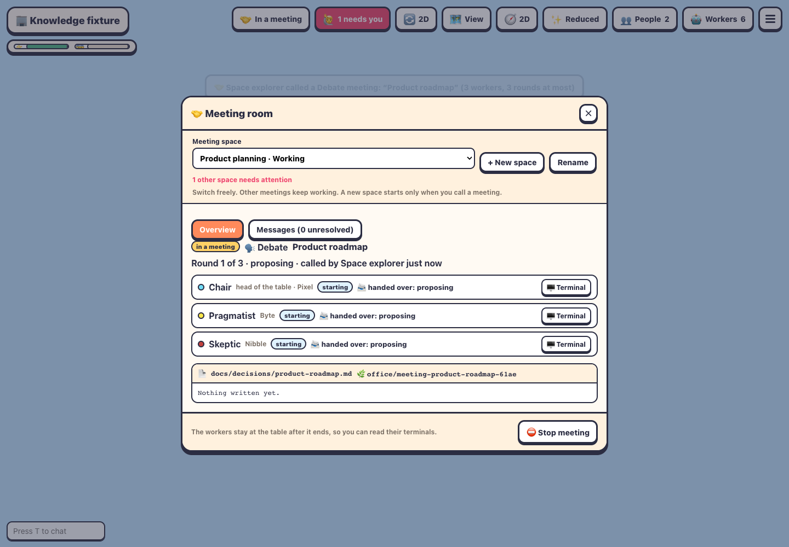

# Meeting spaces

Back to the [README](../README.md).

The floor has one physical meeting room. **Meeting spaces** let you switch which independent meeting appears inside it, without adding rooms or changing the floor, furniture or other office activity.

## Use a space

1. Open **Meeting room** from the **Tab** menu, or press **E** at the meeting table.
2. Use **+ New space** to give a space a name. Creating a space starts no agents and makes no model calls.
3. Select a pattern and **Start the meeting** when you want its agents to work. The existing Debate, Lead & team, Map-reduce, Red / blue and Review panel workflows remain available.
4. Use **Meeting space** to switch at any time. The selected space supplies the room's seated agents, output board, overview, linked messages and history. **Rename** changes its label without changing its work.

Spaces are shared by everyone on a floor, but **selection belongs to each viewer**. Switching yours does not move another person to it. Your selection is remembered per floor in browser storage and restored on reload; with storage disabled it lasts for the current connection.

Each space has its own current meeting and earlier meeting records. Each meeting retains its participants, prompt/agenda, rounds, notes, output preview, tokens and costs, and linked communications. A new meeting in a space follows the existing replacement rules for its previous finished meeting. Clear keeps the completed meeting's history; names and histories survive office restart. The original single-room meeting and history become **Main meeting** automatically.

## Background work and attention

A running meeting continues its rounds when you select another space or close the window. Its agents count toward the existing machine worker limit and budget. Creating or viewing spaces does not start additional background work.

The **N** waiting indicator, top-bar shortcut, and needs-you banner include only agents in your selected space and ordinary floor workers. Background spaces do not appear in that count or navigation; select their space to visit their waiting agents.

The selector shows **Ready**, **Working**, **Needs attention**, **Done**, or **Stopped**. An attention badge identifies other spaces with a worker awaiting input, an offline/exited participant, or an output waiting on communication. Use the space's Overview or Messages to see what needs resolving.

**Stop meeting** and **Clear the room** act only on the selected space. Stop ends that meeting's workflow; it is not a resumable pause. Clear sends that meeting's workers home and archives its result. Other spaces and their workers keep going. Closing with **✕** or **Esc** returns directly to the normal scene controls.

## Isolation and limits

Each running meeting in a Git project gets its own existing meeting worktree. Agents within one meeting share that worktree; meetings in other spaces get different ones. Changes still need normal review/integration. The spaces do not create another floor or duplicate the floor's ordinary whiteboard, cinema, floor chat, desk workers, accounts or budget.

A floor supports up to **16 spaces**, with names of **1–60 characters** unique on that floor. Each space uses the existing bounded history of 20 earlier meetings. For non-Git projects, only one space may run a meeting at a time to avoid concurrent writes into one checkout.

Meeting spaces run on **local floors in the 2D and 3D office**. Hosted-floor meeting execution retains its existing refusal (meetings require participants in one building); creating or renaming spaces on a hosted floor reports that a local floor is required. Lite does not have the meeting-room workflow.

Space labels live in `.agent-office/meeting-spaces.json`. Main meeting uses the original `.agent-office/meetings.json`; other spaces keep their meeting state and archived notes under `.agent-office/meeting-spaces/<id>/`. Space names are display labels; generated IDs determine paths.

## Verification

Run `npm run typecheck`, `npm run build`, and `npm test`. Focused coverage is in `tests/meeting-spaces.test.ts` and the existing meeting tests. Run `node --import tsx scripts/e2e-meeting-spaces.mjs` against the production bundle for real-server browser checks with idle fixture agents, independent worktrees, two viewers, mobile screenshots, and Esc/✕ control restoration. Set `CHROMIUM_PATH` to an installed Chromium executable if needed. Screenshots and `checks.json` go to `/tmp/agent-office-meeting-spaces-evidence` (override with `MEETING_SPACES_ARTIFACTS`). No paid model calls are used by the harness.
